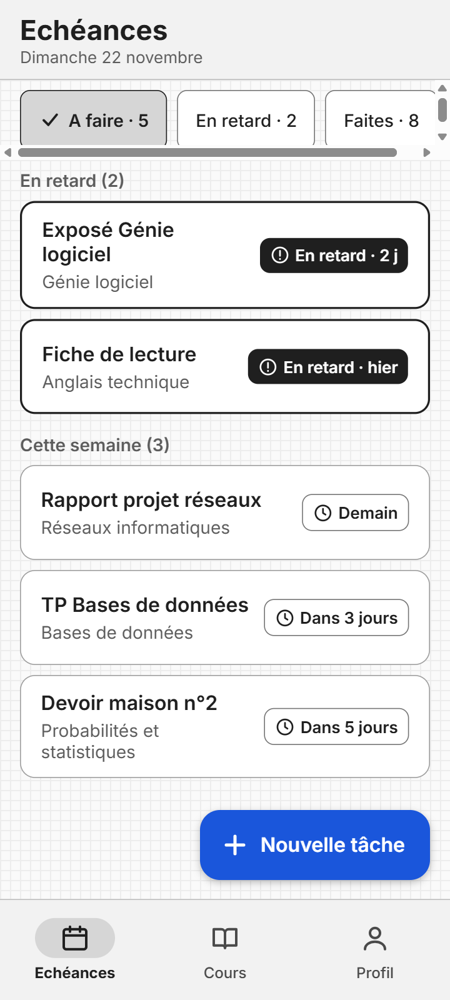
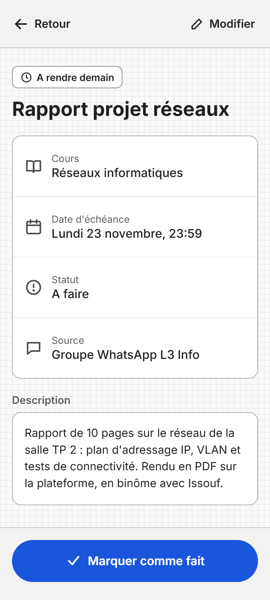
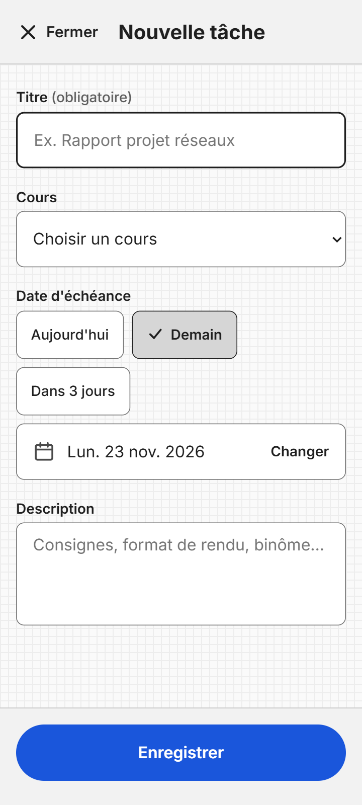
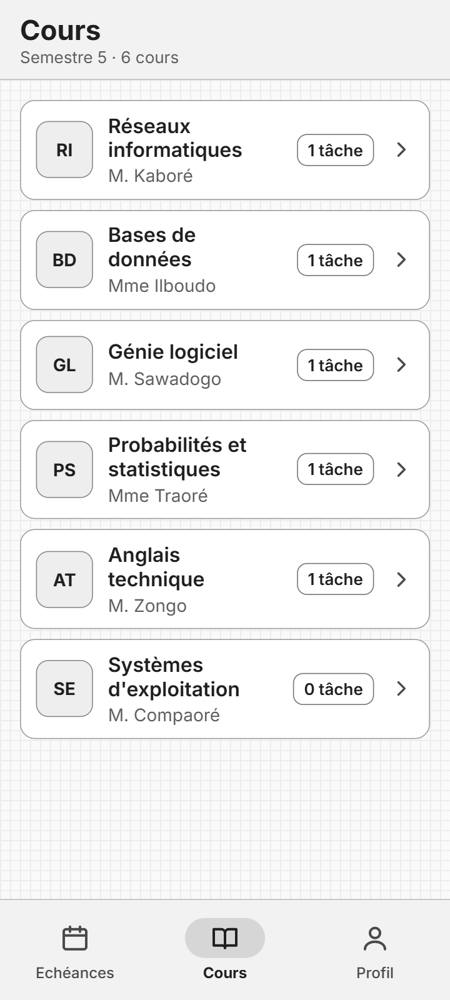
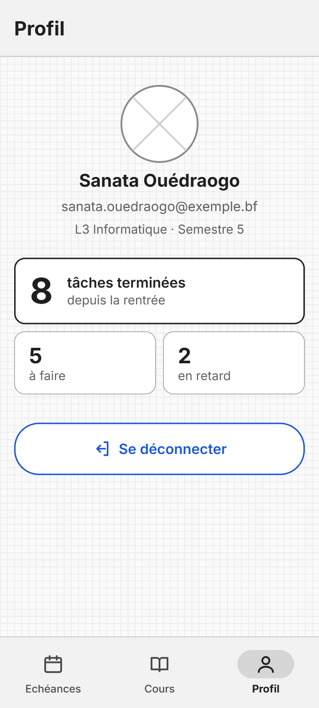
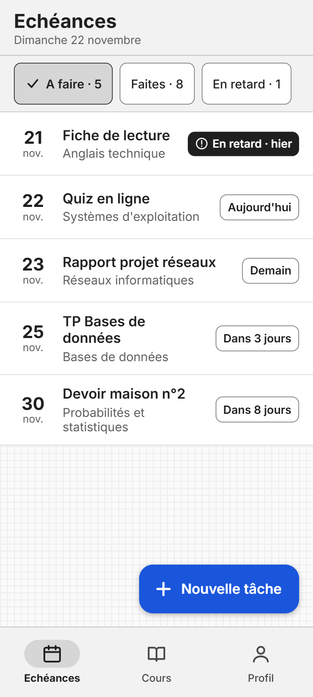
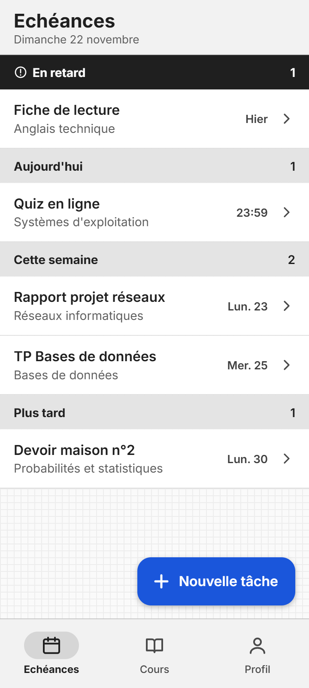
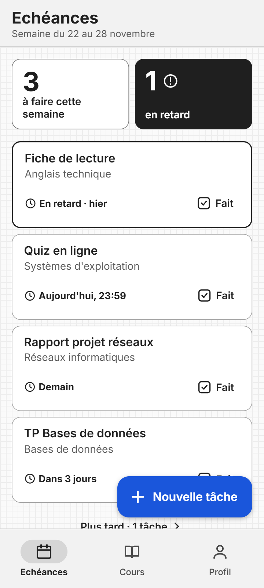
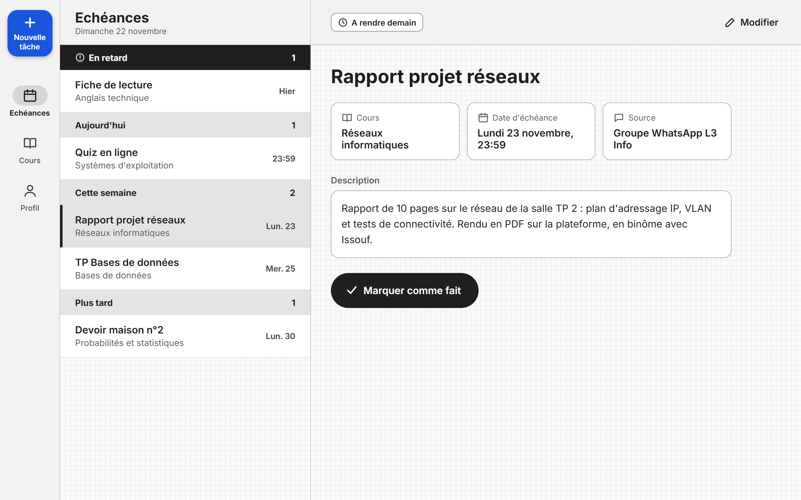

# Séance 2 : wireframes et justification du choix

Les wireframes ont été produits avec **Claude Design** à partir des [briefs](briefs.md), eux-mêmes rédigés depuis le [persona](../persona-job-stories.md) et le [parcours](../parcours.md). Ce sont des écrans de basse fidélité (360×800 dp), en niveaux de gris, avec un seul accent pour l'action principale.

**Transparence.** Les images générées par Claude Design sont présentées sans retouche. Ma part du travail porte sur les briefs, sur la critique des variantes selon la grille du cours, sur le choix final et sur l'ajustement décrit à la section 4.

## 1. Les écrans du parcours principal

Le sujet en demande cinq. Nous en avons dessiné six, pour couvrir toutes les routes de l'application (séance 6).

| Connexion | Échéances | Détail |
|:--:|:--:|:--:|
|  |  |  |
| `/login` | `/taches` | `/taches/:id` |

| Nouvelle tâche | Cours | Profil |
|:--:|:--:|:--:|
|  |  |  |
| `/taches/nouvelle` | `/cours` | `/profil` |

## 2. Trois variantes de l'écran Échéances

C'est l'écran clé du parcours : il couvre les étapes 1 (planifier), 2 (consulter) et 4 (être rappelée).

| A : chronologique + filtres | B : groupée par période | C : résumé + cartes |
|:--:|:--:|:--:|
|  |  |  |

## 3. Critique avec la grille du cours

La grille reprend les cinq questions du cours (séance 2, diapo 19). Les quatre premières correspondent aux critères du sujet : besoin, parcours, accessibilité, faisabilité. La cinquième ajoute la cohérence avec le design system.

Légende : ✓ satisfait · ~ partiellement · ✗ non satisfait

| Question | A : chronologique + filtres | B : groupée par période | C : résumé + cartes |
|---|---|---|---|
| **1. Répond-elle au besoin ?** *(relire la job story 1 : voir ce qui est à rendre et en retard)* | ✓ Les trois filtres avec compteurs sont en haut. Mais le retard n'est qu'un badge parmi les lignes. | ✓ La section **« En retard » est en tête, en noir**. Les périodes « Aujourd'hui », « Cette semaine » et « Plus tard » répondent directement à « planifier ma semaine ». ~ Il manque l'accès aux tâches faites. | ~ Les compteurs se lisent en un coup d'œil, mais il n'y a pas d'accès aux tâches faites. |
| **2. Le parcours est-il le plus court ?** *(compter les appuis)* | Voir les retards : 1 appui (puce). Marquer comme fait : 2 appuis. | Voir les retards : **0 appui**. Marquer comme fait : 2 appuis. | Voir les retards : 0 appui. Marquer comme fait : 1 appui. |
| **3. Est-elle accessible ?** *(contraste, cibles, libellés)* | ✓ Puces d'environ 48 dp et libellées. | ✓ En-têtes très contrastés, lignes pleine largeur faciles à toucher, chevron et date en texte. | ✗ **Le bouton « Nouvelle tâche » masque la case « Fait » de la 4ᵉ carte**, et le lien « Plus tard » est coupé par la barre de navigation. |
| **4. Est-elle réalisable en Flutter ?** *(composants connus)* | ✓ `ListView.builder` + `ListTile` + `FilterChip`. | ✓ Chaque ligne a la forme d'un **`ListTile`** (titre, sous-titre, date et chevron en `trailing`). Il faut intercaler des en-têtes de section dans le `ListView.builder` (logique de regroupement par date). | ✗ Des cartes au lieu de `ListTile`, alors que le sujet impose « chaque ligne est un ListTile » (p. 3). |
| **5. Est-elle cohérente avec le design system ?** | ✓ Les mêmes puces que dans le formulaire. | ✓ La **version tablette** existe déjà (ci-dessous). Les lignes sont identiques sur téléphone et sur tablette. | ~ Le composant « compteur » ne sert qu'ici et dans le Profil. |

## 4. Décision : variante B, avec un ajustement

**Je retiens la variante B (groupée par période).**

- **Besoin et parcours.** C'est la seule variante où les retards sont visibles **sans aucun appui** et où la liste est découpée exactement comme Sanata pense sa semaine : en retard, aujourd'hui, cette semaine, plus tard. Elle répond donc directement à la job story 1 et aux étapes « planifier », « consulter » et « être rappelée » du parcours.
- **Accessibilité.** Elle a les en-têtes les plus contrastés, des lignes pleine largeur faciles à toucher, et aucun élément masqué par le bouton flottant, contrairement à la variante C.
- **Faisabilité.** Les lignes sont des `ListTile` standard, comme l'impose la séance 5. Le regroupement par période se calcule à partir de la date d'échéance, ce qui ne demande aucun composant exotique.
- **Cohérence.** La même structure se décline en largeur étendue, avec la liste et le détail côte à côte au-delà de 840 dp (séance 5) :

**L'ajustement que j'impose à la proposition de l'IA.** Telle qu'elle a été générée, la variante B ne permet pas de voir les tâches **faites**. Or la séance 6 demande trois filtres reliés à l'écran Échéances : à faire, faites, en retard (sujet, p. 4). J'ajoute donc **une rangée de trois filtres au-dessus des sections**, comme dans la variante A. C'est la direction déjà esquissée par l'écran « Échéances » du parcours principal (écran 2), qui combine les puces de A et les sections de B. Ce point est la raison pour laquelle aucune variante n'est acceptée telle quelle : **l'IA a proposé, la décision et l'ajustement sont les miens.**

**Variantes écartées.**
- **A** est plus simple, mais elle relègue le retard au rang de badge et oblige à un appui pour isoler les retards.
- **C** permet de marquer une tâche comme faite en un seul appui, mais elle a un défaut d'accessibilité (bouton flottant superposé) et s'écarte du `ListTile` demandé par le sujet.

## 5. Remarques à corriger lors du passage au code

- Les compteurs ne sont pas cohérents entre l'écran 2 (« En retard · 2 ») et les variantes (1). Dans l'application, ils seront **calculés** à partir des données (fournisseur dérivé, séance 6), donc toujours justes.
- Le contraste des textes gris secondaires (nom du cours, dates) sera vérifié avec le calcul du rapport de 4,5:1 dans le [design system](../design-system-v1.md).
